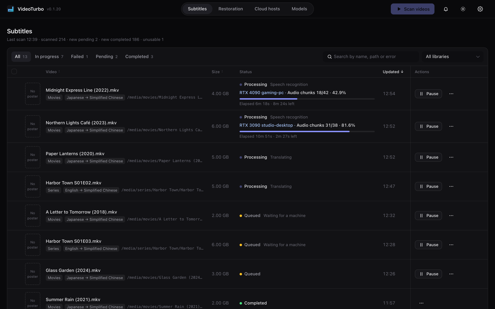
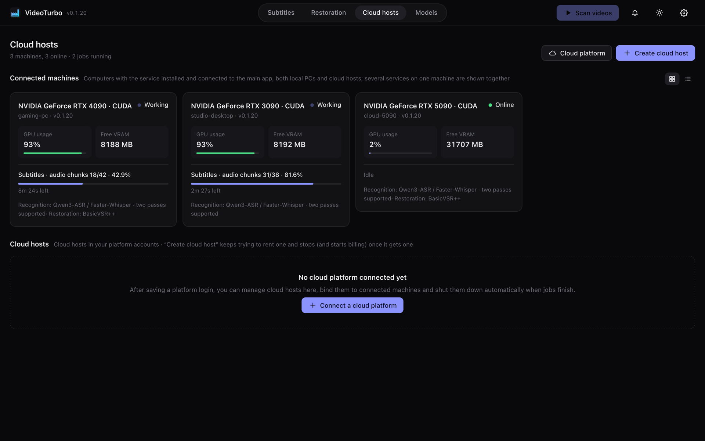
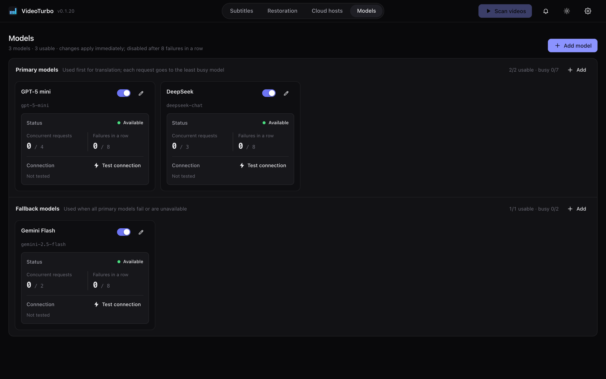

# VideoTurbo

[](https://github.com/VideoTurbo/VideoTurbo/releases/latest)
[](https://github.com/VideoTurbo/VideoTurbo/pkgs/container/videoturbo)
[](https://github.com/VideoTurbo/VideoTurbo/actions/workflows/ci.yml)
[](pyproject.toml)
[](LICENSE)

[简体中文](README.md) | English

A self-hosted tool that adds translated subtitles to your video library. VideoTurbo transcribes the dialogue, translates it
into the language you choose and saves an `.srt` next to each video, ready for Emby / Jellyfin after a refresh.



## Features

- **Automatic subtitles**: Japanese, English or Korean → Simplified Chinese, Traditional Chinese, English and more, with a language pair per library.
- **Skips what it doesn't need**: videos that already have a target-language subtitle are marked completed; videos with source-language text subtitles are translated without speech recognition.
- **Web dashboard**: scan, submit, pause and retry from the browser, in English or Simplified Chinese.
- **Several machines at once**: home PCs and on-demand cloud GPUs can all join; jobs are shared out automatically and cloud hosts shut down when they finish.
- **Optional**: AI video restoration, cloud storage libraries, Emby / Jellyfin refresh, webhook notifications and plugins.

| Connected machines and cloud hosts | Translation models |
| --- | --- |
|  |  |

## How it works

- **Main app**: runs in Docker on a NAS or an always-on machine. It scans, translates, writes subtitles and serves the dashboard.
- **GPU PC**: a Windows or Linux PC with an NVIDIA GPU that does the speech recognition. It only receives compressed audio, so it doesn't need access to your video folders.

Both can be the same machine. You also need an API key for an LLM translation service (any OpenAI-compatible API, or Google Vertex AI).

## Quick start

### 1. Install the main app

Download `docker-compose.example.yml` from [Releases](https://github.com/VideoTurbo/VideoTurbo/releases/latest), rename it to
`docker-compose.yml`, replace `/path/to/your/media` with your video folder and start it:

```sh
docker compose up -d
```

Open `http://<main-app-ip>:8765` and set an admin password (at least 8 characters). **Whoever opens the dashboard first sets it, so do this right after installing.**
To get webhook notifications in English, uncomment `VIDEO_TURBO_LANGUAGE: en` in `docker-compose.yml`.

### 2. First-time setup

1. **Settings → Media libraries**: add the folder that holds your videos and pick the video and subtitle languages.
2. **Models**: add a translation model (API address up to `/v1`) and click **Test connection**.
3. **Settings → Media servers** (optional): add Emby / Jellyfin to refresh libraries after each subtitle.
4. **Settings → Cloud hosts**: copy the **Access key** for the next step.

While something is missing, a yellow banner at the top of the dashboard says what; click it to open the matching settings.

### 3. Set up the GPU PC

Download `video-turbo.zip` from [Releases](https://github.com/VideoTurbo/VideoTurbo/releases/latest), unzip it on the GPU PC,
and run the commands below in the unzipped project folder. The installer asks for the main app address and the access key.

**Windows** (PowerShell):

```powershell
Set-ExecutionPolicy -Scope Process Bypass
.\deploy\worker\windows\worker.ps1
```

Choose “Install”, then “Start”. If Python 3.11 is missing, run `worker.ps1 install -InstallPython`.
It then starts in the background whenever you sign in to Windows and only takes jobs while the GPU is idle.

**Linux** (tested with RTX 3090 / 4090 / 5090 on Ubuntu 24.04; driver 525 or newer, 570 or newer for RTX 5090):

```sh
bash deploy/worker/linux/worker.sh install asr
bash deploy/worker/linux/worker.sh start
```

The first start downloads the models (several GB) and runs a self-test. The PC then shows up under **Connected machines** on the **Cloud hosts** tab.

### 4. Generate subtitles

Click **Scan videos** at the top, tick videos under **Subtitles → Pending** and click **Generate subtitles**. The subtitle is saved next to the video,
e.g. `Movie.zh.default.srt`. Scanning never starts jobs by itself; try a single video first.

| Language | Source | Target | Subtitle file |
| --- | --- | --- | --- |
| Japanese | ✓ | ✓ | `Movie.ja.default.srt` |
| English | ✓ | ✓ | `Movie.en.default.srt` |
| Korean | ✓ | ✓ | `Movie.ko.default.srt` |
| Simplified Chinese | | ✓ | `Movie.zh.default.srt` |
| Traditional Chinese | | ✓ | `Movie.zh-TW.default.srt` |

## More features

- **Recognition mode**: Qwen3-ASR by default; switch to Faster-Whisper under **Settings → Subtitles**. Only new jobs are affected.
- **Video restoration**: uses [Jasna](https://github.com/Kruk2/jasna) on Linux GPU PCs only (driver 580 or newer).
  Install with `worker.sh install restore` and `worker.sh start restore`; the first start compiles the models, which takes about 15–60 minutes.
  The restored video is named `Movie-U.mp4` and the original moves to the backup folder.
- **Cloud GPU**: rent GPUs on demand from the **Cloud hosts** tab; the main app installs the service for you, with no public IP or port forwarding.
  **Billing starts as soon as a host is rented**; bind it to shut down automatically when jobs finish. Platforms joined over SSH must be shut down on the platform yourself.
- **Cloud storage libraries**: with a storage plugin, a cloud folder works as a library and the machines download videos directly. The storage account settings are sent to those machines with each job.
- **Plugins**: install cloud platform, media server, cloud storage and notification plugins from a URL, a local file or a plugin repository under **Settings → Plugins**.
  **Plugins can read every key the main app stores; only install plugins you trust.** To write one, see the `base.py` of each plugin type under `src/video_turbo/`
  and the examples in [VideoTurboPlugins](https://github.com/VideoTurbo/VideoTurboPlugins).

## FAQ

**Forgot the admin password?**
Stop the main app, run this in the folder with `docker-compose.yml`, then start it again and set a new password:

```sh
sqlite3 data/app.db "DELETE FROM runtime_settings WHERE key = 'admin_auth';"
```

**Jobs stuck at “Waiting for translation”?**
No translation model is available. On the **Models** tab check the key, the **Accepting jobs** switch and **Test connection**; jobs continue once it works.

**GPU PC and main app on different networks?**
Join both to the same [Tailscale](https://tailscale.com/) network. **Never expose port 8765 to the internet**;
if you must, expose only the machine port 8766 behind an HTTPS reverse proxy.

**The main app won't start after installing a plugin?**
Add `VIDEO_TURBO_SAFE_MODE: "1"` under `environment` in `docker-compose.yml`, restart, uninstall the plugin, then remove the line.

**Logs**

```sh
docker compose logs -f orchestrator                 # main app (also saved to logs/server.log)
bash deploy/worker/linux/worker.sh logs asr -f      # Linux GPU PC
.\deploy\worker\windows\worker.ps1 logs -Follow     # Windows GPU PC
```

## Updating

- **Main app**: run `docker compose pull && docker compose up -d`. Data is kept and the database upgrades itself.
- **GPU PC**: download the new `video-turbo.zip`, **merge it over** the existing project folder, then run the install again.

Update both together; machines with a different version can't connect.

## Contributing

Issues and pull requests are welcome. See [CONTRIBUTING.md](CONTRIBUTING.md) for the development setup and conventions.

## Credits

- [WhisperJAV](https://github.com/meizhong986/WhisperJAV): the recognition pipeline of the default mode.
- [Qwen3-ASR](https://huggingface.co/Qwen/Qwen3-ASR-1.7B), [anime-whisper](https://huggingface.co/litagin/anime-whisper): speech recognition models.
- [faster-whisper](https://github.com/SYSTRAN/faster-whisper): the Faster-Whisper mode.
- [Jasna](https://github.com/Kruk2/jasna): video restoration.
- FFmpeg, FastAPI, Vue, Naive UI and other open-source projects.

VideoTurbo doesn't ship code or model weights from these projects; they are downloaded from their official sources during installation and keep their own licenses.

## License

[AGPL-3.0-or-later](LICENSE). If you distribute a modified version, or offer one as a network service, you must publish its source under the same license.

**🚫 Do not use this project to make or spread illegal content or to infringe the rights of others.**
