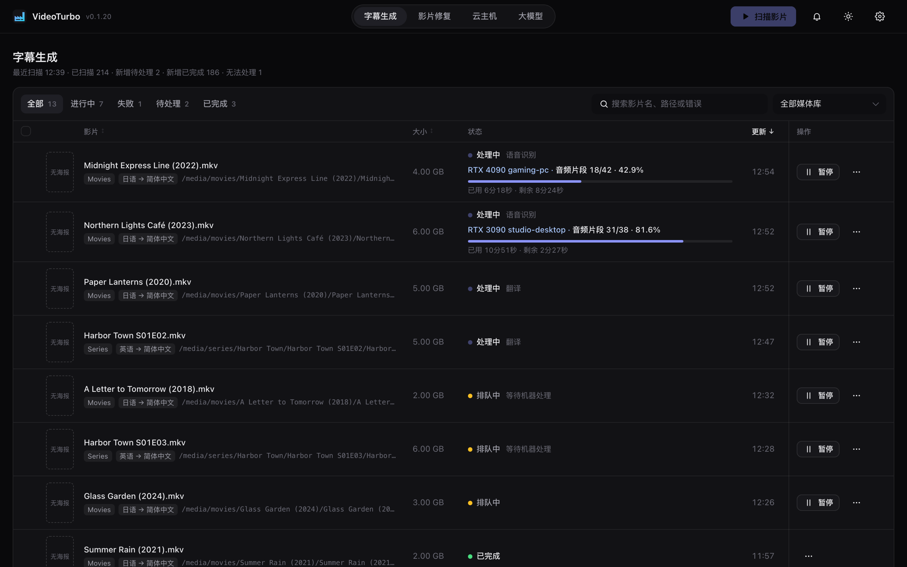
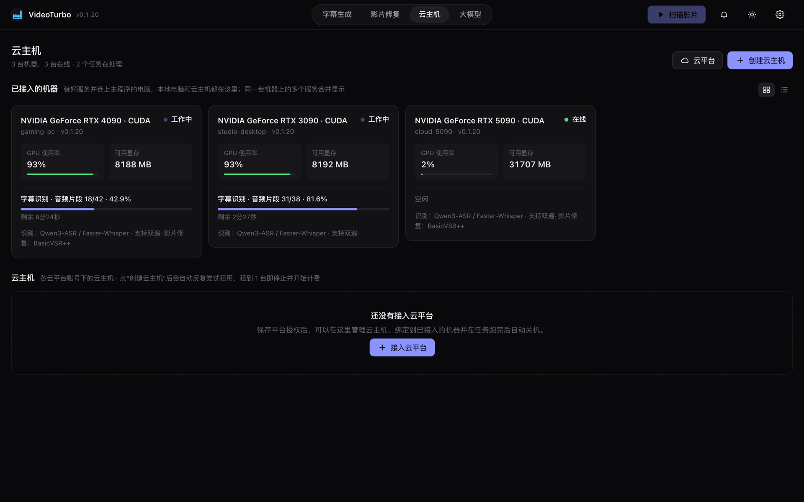
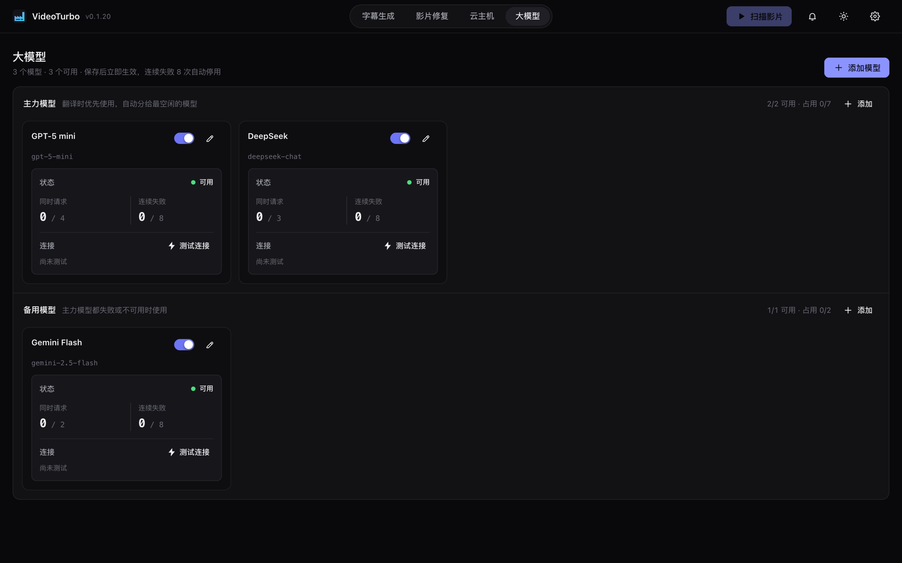

# VideoTurbo

[](https://github.com/VideoTurbo/VideoTurbo/releases/latest)
[](https://github.com/VideoTurbo/VideoTurbo/pkgs/container/videoturbo)
[](https://github.com/VideoTurbo/VideoTurbo/actions/workflows/ci.yml)
[](pyproject.toml)
[](LICENSE)

简体中文 | [English](README.en.md)

给影片库自动生成翻译字幕的自托管工具：VideoTurbo 识别影片里的对白、翻译成你要的语言，在影片旁边写好 `.srt`，
Emby / Jellyfin 刷新后就能直接选用。



## 功能

- **自动生成字幕**：日语、英语、韩语影片 → 简体中文、繁体中文、英语等，每个媒体库单独选语言。
- **跳过不需要的影片**：已有目标语言字幕的直接记为已完成；自带原文字幕的只翻译、不识别。
- **网页控制台**：扫描、提交、暂停、重试都在浏览器里完成，界面支持简体中文和英文。
- **多台机器一起干活**：家里的游戏本、台式机或按需租用的云 GPU 都能接入，任务自动分配，云主机跑完自动关机。
- **可选功能**：AI 影片修复、网盘媒体库、Emby / Jellyfin 自动刷新、Webhook 推送，以及插件扩展。

| 已接入的机器与云主机 | 翻译模型 |
| --- | --- |
|  |  |

## 工作方式

- **主程序**：用 Docker 装在 NAS 或常开的电脑上，负责扫描、翻译、写字幕和网页控制台。
- **显卡电脑**：有 NVIDIA 显卡的 Windows 或 Linux 电脑，负责语音识别。主程序只发压缩后的音频过去，不用共享影片文件夹。

两者可以是同一台机器。你还需要一个大模型翻译接口的 API Key（OpenAI 兼容接口或 Google Vertex AI）。

## 快速开始

### 1. 安装主程序

从 [Releases](https://github.com/VideoTurbo/VideoTurbo/releases/latest) 下载 `docker-compose.example.yml`，改名为
`docker-compose.yml`，把里面的 `/path/to/your/media` 改成影片所在的文件夹，然后启动：

```sh
docker compose up -d
```

浏览器打开 `http://主程序的IP:8765`，设置管理口令（至少 8 位）。**谁先打开谁设置，装好后请马上完成。**

### 2. 首次设置

1. **系统设置 → 媒体库**：添加影片所在的文件夹，选影片语言和字幕语言。
2. **大模型**：添加翻译模型（接口地址写到 `/v1` 为止），点“测试连接”确认能连上。
3. **系统设置 → 媒体服务器**（可选）：添加 Emby / Jellyfin，字幕生成后自动刷新。
4. **系统设置 → 云主机**：复制接入密钥，下一步要用。

配置不完整时，控制台顶部会出现黄色提示，点击即可跳到对应设置。

### 3. 在显卡电脑上安装服务

从 [Releases](https://github.com/VideoTurbo/VideoTurbo/releases/latest) 下载 `video-turbo.zip` 解压到显卡电脑，
在解压出的项目文件夹里运行下面的命令，按提示填写主程序地址和接入密钥。

**Windows**（PowerShell）：

```powershell
Set-ExecutionPolicy -Scope Process Bypass
.\deploy\worker\windows\worker.ps1
```

在菜单里选“安装”，再选“启动”。没有 Python 3.11 时运行 `worker.ps1 install -InstallPython` 自动安装。
装好后登录 Windows 会自动在后台启动，并且只在显卡空闲时接任务。

**Linux**（适配 RTX 3090 / 4090 / 5090，推荐 Ubuntu 24.04，驱动 525 以上，5090 需要 570 以上）：

```sh
bash deploy/worker/linux/worker.sh install asr
bash deploy/worker/linux/worker.sh start
```

第一次启动会下载模型（几个 GB）并自检。控制台“云主机”页的“已接入的机器”里出现这台电脑就说明连上了。

### 4. 生成字幕

点顶部的“**扫描影片**”，在“字幕生成 → 待处理”里勾选影片，点“**生成字幕**”。字幕写在影片旁边，例如 `电影名.zh.default.srt`。
扫描不会自动开始任务，建议先选一部试试。

| 语言 | 原文 | 译文 | 字幕文件名 |
| --- | --- | --- | --- |
| 日语 | ✓ | ✓ | `片名.ja.default.srt` |
| 英语 | ✓ | ✓ | `片名.en.default.srt` |
| 韩语 | ✓ | ✓ | `片名.ko.default.srt` |
| 简体中文 | | ✓ | `片名.zh.default.srt` |
| 繁体中文 | | ✓ | `片名.zh-TW.default.srt` |

## 进阶功能

- **识别模式**：默认 Qwen3-ASR，也可以在“系统设置 → 字幕生成”换成 Faster-Whisper，只影响新任务。
- **影片修复**：用 [Jasna](https://github.com/Kruk2/jasna) 修复画面，仅支持 Linux 显卡电脑（驱动 580 以上）。
  运行 `worker.sh install restore` 和 `worker.sh start restore` 安装，首次启动要编译模型，约 15–60 分钟。
  修复后的影片命名为 `原片名-U.mp4`，原片移到备份目录。
- **云 GPU**：在“云主机”页按需租用，主程序自动在云主机上装好服务，不需要公网 IP 或端口转发。**租到就开始计费**，
  绑定后可以设为跑完自动关机；通过 SSH 登录接入的平台需要自己去平台关机。
- **网盘媒体库**：安装网盘插件后可以把网盘目录当媒体库，影片由处理任务的机器直接下载。网盘账号设置会随任务发给这些机器。
- **插件**：在“系统设置 → 插件”按地址、本地文件或插件仓库安装云平台、媒体服务器、网盘和通知插件。
  **插件能读取主程序保存的所有密钥，只安装你信任的插件。** 想自己写插件，接口说明见 `src/video_turbo/` 下各类插件的 `base.py`，
  示例见 [VideoTurboPlugins](https://github.com/VideoTurbo/VideoTurboPlugins)。

## 常见问题

**忘记管理口令？**
停止主程序，在 `docker-compose.yml` 所在的文件夹运行下面的命令，再启动主程序重新设置：

```sh
sqlite3 data/app.db "DELETE FROM runtime_settings WHERE key = 'admin_auth';"
```

**任务一直停在“等待翻译”？**
没有可用的翻译模型。到“大模型”页检查 Key、“接收任务”开关和连接测试，修好后自动继续。

**显卡电脑和主程序不在同一个局域网？**
推荐都加入同一个 [Tailscale](https://tailscale.com/) 网络。**不要把 8765 端口直接映射到公网**；
必须走公网时只映射机器接入端口 8766，并配上 HTTPS 反向代理。

**装了插件后主程序打不开？**
在 `docker-compose.yml` 的 `environment` 里加 `VIDEO_TURBO_SAFE_MODE: "1"` 重启，卸载这个插件后再删掉这一行。

**查看日志**

```sh
docker compose logs -f orchestrator                 # 主程序（也保存在 logs/server.log）
bash deploy/worker/linux/worker.sh logs asr -f      # Linux 显卡电脑
.\deploy\worker\windows\worker.ps1 logs -Follow     # Windows 显卡电脑
```

## 更新

- **主程序**：运行 `docker compose pull && docker compose up -d`，数据会保留，数据库自动升级。
- **显卡电脑**：下载新版 `video-turbo.zip`，**合并覆盖**到原来的项目文件夹，再运行一次安装。

主程序和显卡电脑要一起更新，版本不一致时机器无法接入。

## 参与贡献

欢迎提交 Issue 和 PR，开发环境和提交规范见 [CONTRIBUTING.md](CONTRIBUTING.md)。

## 致谢

- [WhisperJAV](https://github.com/meizhong986/WhisperJAV)：默认识别模式的识别流程。
- [Qwen3-ASR](https://huggingface.co/Qwen/Qwen3-ASR-1.7B)、[anime-whisper](https://huggingface.co/litagin/anime-whisper)：语音识别模型。
- [faster-whisper](https://github.com/SYSTRAN/faster-whisper)：Faster-Whisper 模式。
- [Jasna](https://github.com/Kruk2/jasna)：影片修复。
- FFmpeg、FastAPI、Vue、Naive UI 等开源项目。

本项目不包含上述项目的代码或模型权重，安装时从各自官方来源下载，许可证以其官方为准。

## 许可证

[AGPL-3.0-or-later](LICENSE)。分发修改版，或把修改版作为网络服务提供给他人时，需要以相同许可证公开源代码。

**🚫禁止将本项目用于制作、传播违法内容或侵犯他人权益。**
